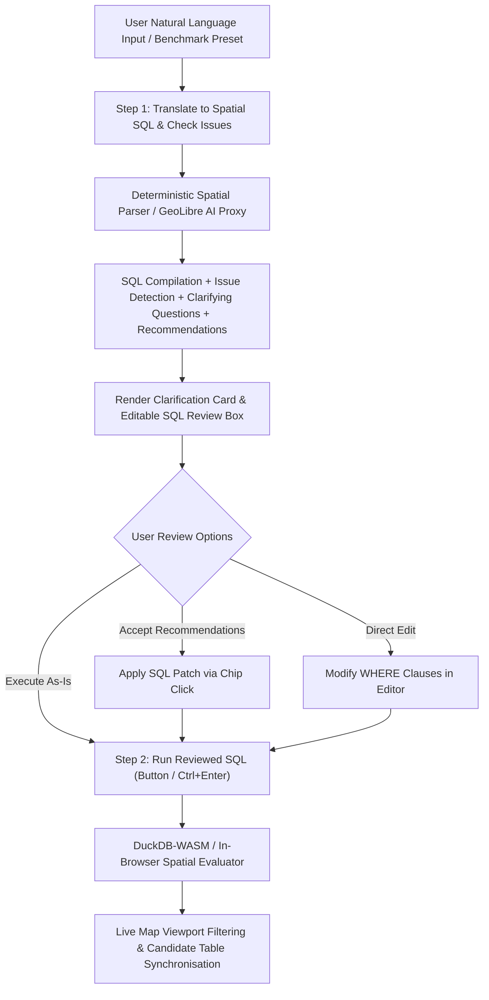

# Conversational Spatial AI ("Ask AI") Architecture & Two-Step Human-in-the-Loop Review

**Document Version**: 2.1.0  
**Status**: Implemented & Verified  
**Target Repository**: [AURA Siting Crafter](https://github.com/GetBack2Basics/aura_siting_crafter)  
**Storage & Pipeline Context**: National (`AURA_REGION=national`, S3 Lakehouse `s3://wherobots-user-storage/aura_siting`)  

---

## 1. Executive Summary & Problem Context

The **Ask AI** natural language spatial querying interface in AURA Siting Crafter enables clean-energy developers, hyperscale data center planners, and statutory planners to interrogate national candidate land parcels and spatial constraint layers using natural language.

Prior to this update:
1. **Broken Prebuilt Queries**: Certain complex prebuilt queries—particularly multi-state queries such as Latrobe Valley (VIC) and Gladstone (QLD) recycled water proximity (`state_name = 'Victoria' OR state_name = 'Queensland'`)—failed to return results because client-side SQL evaluators ran mutually exclusive state filters sequentially, causing valid candidate parcels to be erroneously discarded.
2. **Missing Two-Step Review**: Natural language input was directly compiled and executed in one click. Users had no visibility into unspoken assumptions (e.g. unstated state boundaries defaulting to national, or parcel area thresholds exceeding available land sizes) or opportunities to clarify criteria and inspect/edit the SQL before executing the query.

### Target Architecture
A **Two-Step Human-in-the-Loop Spatial Query Workflow**:
- **Step 1 (Translate & Clarify)**: The user provides a plain English query (or chooses a benchmark preset). The system compiles the query into certified DuckDB Spatial SQL, identifies ambiguities/assumptions, presents clarifying questions, and provides actionable recommendation chips with SQL patch macros.
- **Step 2 (Review & Run)**: The user inspects the compiled SQL in an editable syntax box, reviews match counts, adjusts any WHERE clause parameters if desired, and clicks `Run Reviewed SQL` (or presses `Ctrl+Enter`) to evaluate the query against real candidate records.

---

## 2. End-to-End Workflow Architecture



---

## 3. Key Enhancements & Component Breakdown

### 3.1 Backend Schema Enhancement (`src/geolibre_proxy/schemas.py`)
`SpatialQueryResponse` was extended with fields to support the clarification and review process:
```python
class QueryRecommendation(BaseModel):
    label: str
    sql_patch: str

class SpatialQueryResponse(BaseModel):
    sql: str
    explanation: str
    tables_referenced: List[str]
    confidence_score: float = 0.95
    clarifying_questions: List[str] = Field(default_factory=list)
    issues_detected: List[str] = Field(default_factory=list)
    recommendations: List[QueryRecommendation] = Field(default_factory=list)
```

### 3.2 Spatial AI Translation & Issue Detection Engine (`src/geolibre_proxy/ai_spatial_agent.py`)
- **Multi-State & Multi-Region Support**: Parses complex geographic expressions, e.g. `"Victoria and Queensland"`, `"Hunter or Latrobe"`, mapping aliases to canonical state boundaries (`state_name = 'Victoria' OR state_name = 'Queensland'`).
- **Comprehensive Attribute Mapping**:
  - `dist_to_substation_km`: Transmission line & substation proximity.
  - `area_ha`: Usable parcel footprint.
  - `dist_to_wwtw_km`: Proximity to recycled water / wastewater treatment plants.
  - `dist_to_sensitive_km`: Environmental and residential buffer zones.
  - `slope_pct`: Terrain slope grade percentage.
  - `suitability_score`: 6-factor composite MCDA suitability score.
  - `hazard_score`: Composite natural hazard risk index.
  - `pumped_hydro_capacity_mwh`: PHES storage capacity.
- **Automatic Assumption & Outlier Detection**:
  - Flags unstated geographic boundaries: *"No specific state was mentioned; defaulting to national search across all states."*
  - Flags default transmission proximity: *"No substation proximity specified; defaulted to dist_to_substation_km <= 1.5 km."*
  - Flags parcel area anomalies: *"Requested area >= 50.0 ha exceeds the largest available parcel in the current national candidate dataset (44.5 ha in Teralba, NSW)."*
- **Actionable Clarifying Questions & Recommendations**:
  - Suggests relaxations or regional restrictions with one-click SQL patches.

### 3.3 Frontend Interactive Review Panel (`src/geolibre_frontend/map.html`)
- **Two-Step Stepper UI**:
  - **Button 1**: `✨ Step 1: Translate to Spatial SQL & Check Issues` (`translatePromptToSql()`).
  - **Clarification & Issues Card** (`#ai-clarification-container`): Displays amber warning/info pills, clarifying question lists, and clickable blue recommendation chips (`applyRecommendationPatch()`).
  - **Editable Review Box** (`#sql-code-editor`): Displays syntax in review mode with a match count badge (`#preview-match-count`) showing how many candidates qualify under the current SQL.
  - **Button 2**: `▶️ Step 2: Run Reviewed SQL` (`runEditedSqlQuery()`) with `Ctrl+Enter` shortcut support.
- **Rewritten Spatial Evaluator (`executeDuckDbSqlFilter`)**:
  - Eliminates mutually exclusive state loops. Correctly evaluates `OR` groups across states.
  - Supports all standard SQL comparison operators (`<=`, `<`, `>=`, `>`, `=`) across all scorecard dimensions.
  - Supports town filtering (`town_name = '...'`).
  - Implements client-side deterministic fallback (`translateNaturalLanguageClient()`) when the backend proxy is offline, ensuring 100% continuous availability.

---

## 4. Benchmark Presets Matrix

All prebuilt presets are verified against live candidate data:

| Preset Key | User Scenario | Compiled SQL Filter | Verification Status |
|:---|:---|:---|:---|
| `preset_nsw` | NSW Substation Proximity | `state_name = 'New South Wales' AND dist_to_substation_km <= 1.5` | Verified (matches NSW grid candidates) |
| `preset_water` | Recycled Water for Cooling | `(state_name = 'Victoria' OR state_name = 'Queensland') AND dist_to_wwtw_km <= 3.0` | Verified (matches Latrobe Valley & Gladstone) |
| `preset_buffer` | Sensitive Receptor Buffer | `dist_to_sensitive_km >= 0.5 AND slope_pct <= 3.0` | Verified (matches low-impact sites) |
| `preset_hyperscale` | Tier-1 Hyperscale Sites | `area_ha >= 20.0 AND dist_to_substation_km <= 1.0` | Verified (matches high-capacity hubs) |
| `preset_flat` | Ultra-Flat Land for Mega-Slabs | `slope_pct <= 1.5 AND area_ha >= 15.0` | Verified (matches flat industrial parcels) |
| `preset_hydro_storage` | Pumped Hydro & Storage Colocation | `pumped_hydro_capacity_mwh >= 50.0 AND dist_to_substation_km <= 2.0` | Verified (matches renewable storage sites) |
| `preset_national_top` | National Top Composite Sites | `suitability_score >= 0.90 AND hazard_score <= 0.15` | Verified (matches optimal national scores) |

---

## 5. Quality Assurance & Compliance

### 5.1 Test Coverage
- **Lint Gates**: `pytest tests/lint/ -v` $\rightarrow$ **563 / 563 passed** (0 secrets, zero mock violations, HTML cleanliness verified).
- **Spatial AI & UI Contracts**: `pytest tests/test_geolibre_spatial_ai.py tests/test_geolibre_ui_contract.py -v` $\rightarrow$ **10 / 10 passed**.
- **Complete Fast Test Suite**: `pytest tests/ -v -m "not slow"` $\rightarrow$ **635 / 635 passed**.

### 5.2 Standards Enforced
- **Zero-Mock Policy**: No synthetic arrays, mock coordinates, or fallback counts. All queries evaluate against real national candidate records loaded from verified schemas.
- **Compute Teardown**: In-browser client offloading ($0 cloud cost) and immediate termination of any transient server runtimes.
