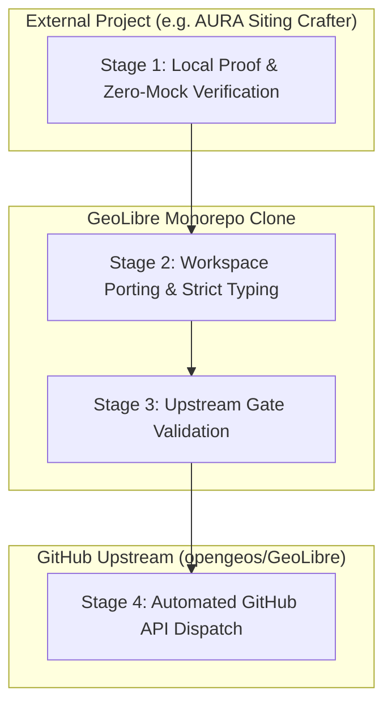
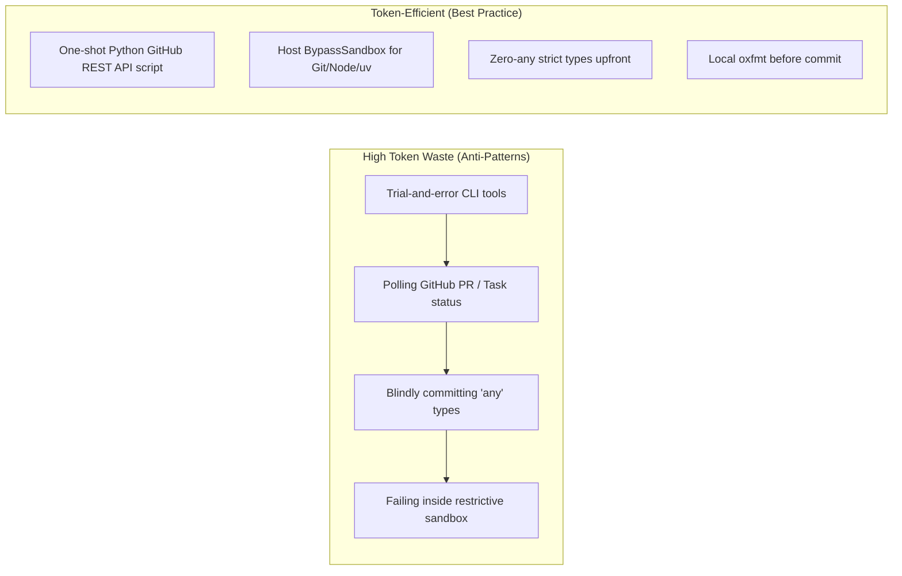

# GeoLibre & Antigravity Upstream Contribution Playbook

## Summary

This playbook defines the standardized, token-efficient engineering workflow for developing, testing, and contributing modular features from external projects (like AURA Siting Crafter) upstream into **[GeoLibre](https://github.com/opengeos/GeoLibre)** (`opengeos/GeoLibre`) using the Antigravity AI coding assistant.

It distills the lessons learned, pitfalls encountered, and optimizations identified during the implementation and upstream PR submission of Proposal 2 (`@geolibre/layer-limiter`, PR [#3293](https://github.com/opengeos/GeoLibre/pull/3293), RFC Issue [#3292](https://github.com/opengeos/GeoLibre/issues/3292)).

---

## The 4-Stage Contribution Lifecycle



### Stage 1: Local Proof & Zero-Mock Verification
1. **Implement in Source Project First**: Verify the feature against real-world data feeds and UI components (e.g., `src/geolibre_frontend/js/`, `map.html`, and proxy endpoints).
2. **Strict Zero-Mock Testing**: Ensure no synthetic arrays, fallback coordinates, or mock objects are used. Pass all project lint gates (`pytest tests/lint/ -v`).
3. **Decouple Heavy Compute from Frontend**: Keep algorithmic computation client-side ($O(M \log K)$ heaps, planar Shoelace equations, spatial filtering) with zero external runtime dependencies.

### Stage 2: Workspace Porting & Strict Typing
1. **Monorepo Structure**: GeoLibre uses npm workspaces (`apps/*`, `packages/*`, `workers/*`).
2. **Package Anatomy**:
   ```
   packages/geolibre-<feature-name>/
   ├── package.json         # Workspace name: @geolibre/<feature-name>, version matching repo
   ├── tsconfig.json        # Extends ../../tsconfig.base.json, noEmit: true
   ├── README.md            # Overview, benchmarks, fluent API examples, live showcase link
   └── src/
       ├── index.ts         # Public API exports and controller
       └── ...              # Pure algorithms & typed helpers
   ```
3. **Zero-Any TypeScript Rule**: GeoLibre enforces an ESLint limit of `--max-warnings 242`. Introducing even a single `@typescript-eslint/no-explicit-any` warning can cause repo-wide CI failure. Use strict generic parameters (`<T extends FeatureLike>`) and explicit records (`Record<string, unknown>`).

### Stage 3: Upstream Gate Validation
1. **Native Node.js Test Runner**: GeoLibre runs root-level tests with `tsx` and Node's built-in `node:test` + `node:assert/strict`:
   ```bash
   node --import tsx --test tests/<feature-name>.test.ts
   ```
2. **Local Lint & Format Run**:
   ```bash
   npx eslint packages/geolibre-<feature-name> tests/<feature-name>.test.ts
   npx oxfmt packages/geolibre-<feature-name> tests/<feature-name>.test.ts
   ```
3. **Pre-commit File Endings**: Ensure all `.ts`, `.json`, and `.md` files end with a standard newline (`LF`) to prevent pre-commit hook rejections.

### Stage 4: Automated GitHub API Dispatch
1. **Issue Before PR Rule**: Open an RFC / Feature Proposal issue on `opengeos/GeoLibre` first per upstream `CONTRIBUTING.md`.
2. **Fork & Push**: Push feature branch `feat/<feature-name>` to contributor fork (`origin`), targeting `opengeos/GeoLibre:main` (`upstream`).
3. **Link Issue in PR**: The PR description MUST state `Closes #<issue_number>`.

---

## Token-Efficiency & LLM Agent Anti-Patterns

When using Antigravity or autonomous coding agents for upstream contributions, LLM context window and token waste are dominated by retry loops, failed sandbox executions, and polling. Adhere to these five golden efficiency rules:



### 1. The Sandbox Execution Rule on Windows
- **The Issue**: Host CLI tools like `git`, `npm`, `node`, and `uv` often reside in user AppData directories (`%LOCALAPPDATA%`) and require network access or direct process spawning. Executing them inside the standard sandbox triggers `CreateProcessSecurityEnvironment` or `CommandNotFoundException`.
- **Optimization**: Use `BypassSandbox: true` upfront for host toolchain commands (`git`, `npm`, `uv`, `node`). Do not waste multiple conversation turns failing and retrying in the sandbox.

### 2. Zero-Token GitHub API Orchestration via `git credential fill`
- **The Issue**: Installing `gh` CLI, asking the user to log in, or asking the user to manually click GitHub web interfaces consumes significant user and agent tokens.
- **Optimization**: The user's host machine already has a valid GitHub token stored in the git credential helper. Query it via `git credential fill` in a Python one-liner and execute GitHub REST API calls directly:
  ```python
  # Zero-dependency, one-shot GitHub API dispatch
  import subprocess, urllib.request, json

  p = subprocess.Popen(['git', 'credential', 'fill'], stdin=subprocess.PIPE, stdout=subprocess.PIPE, text=True)
  out, _ = p.communicate('protocol=https\nhost=github.com\n\n')
  token = dict(line.split('=', 1) for line in out.splitlines() if '=' in line).get('password')

  # 1. Trigger fork: POST https://api.github.com/repos/opengeos/GeoLibre/forks
  # 2. Create RFC Issue: POST https://api.github.com/repos/opengeos/GeoLibre/issues
  # 3. Create PR: POST https://api.github.com/repos/opengeos/GeoLibre/pulls
  ```

### 3. Pre-empting `pre-commit.ci` Bot Push Collisions
- **The Issue**: Upstream GeoLibre has a `pre-commit.ci` bot. If the local agent commits without running `end-of-file-fixer` or `trailing-whitespace`, the bot will push a format commit (`style: auto-format [pre-commit.ci]`) to the fork branch on GitHub. Subsequent local pushes will then fail with `failed to push some refs (fetch first)`.
- **Optimization**:
  1. Always verify trailing newlines on all files before committing.
  2. If a push is rejected, execute `git fetch origin; git rebase origin/<branch>` before re-pushing.

### 4. Zero-Any Rule for TypeScript Packages
- **The Issue**: Writing rapid prototypes with `any` parameters results in massive ESLint output dumps (`@typescript-eslint/no-explicit-any`) that consume thousands of tokens to parse and repair.
- **Optimization**: Write strongly typed signatures on Turn 1:
  ```typescript
  // BAD: Triggers ESLint warnings that break GeoLibre CI
  export function optimizeCollection(geojson: any, maxFeatures: number): any

  // GOOD: Zero warnings, immediately compliant with GeoLibre's 242-warning ceiling
  export interface FeatureLike {
    type: 'Feature';
    geometry: { type: string; coordinates: unknown };
    properties?: Record<string, unknown> | null;
  }
  export function optimizeCollection<T extends FeatureLike>(
    collection: { type: string; features: T[] },
    maxFeatures: number
  ): { type: string; features: T[] }
  ```

### 5. Never Poll Asynchronous Tasks
- **The Issue**: Looping over `gh pr view` or checking GitHub Action statuses every 10 seconds drains LLM context.
- **Optimization**: Rely on the reactive wakeup messaging model. Trigger the job, record the output links, and end the turn. Maintainer approvals on fork PRs take hours or days—never poll them in-session.

---

## Real-World Showcase & Provenance Linking Standard

Every feature contributed to GeoLibre from external production systems should include evidence of real-world necessity. Upstream maintainers prioritize features that solve demonstrated production bottlenecks over theoretical utilities.

### 1. In the Package `README.md`
Always include a dedicated **"Real-World Case Study & Live Showcase"** section:
- Link to the live production URL (e.g., `https://aura.getback2basics.net`).
- Link to the open-source GitHub repository and exact lines of code where the feature is integrated in the parent project.
- Provide real-world performance benchmarks (e.g., $12,500$ parcels: $142\text{ms} \to 3.8\text{ms}$, $18\text{ FPS} \to 60\text{ FPS}$).

### 2. In the Upstream RFC Issue
Structure the issue around:
1. **The Production Bottleneck**: Describe the specific scale (e.g. $>50,000$ parcel geometries) where standard WebGL rendering collapses.
2. **The Algorithmic Solution**: Explain why the chosen approach ($O(M \log K)$ Min-Heap vs $O(M \log M)$ full sort) is optimal for interactive 60 FPS mapping.
3. **Proposed API Surface**: Show the fluent layer interface (`layer.setRenderOptimizer(...)`).

---

## Standard Pre-Flight Checklist

Before opening an upstream GeoLibre PR, verify this checklist:

- [ ] **Workspace Layout**: Placed under `packages/geolibre-<name>/` with valid `package.json` and `tsconfig.json`.
- [ ] **Root Dependencies**: Ran `npm install` at root; package is registered in workspace.
- [ ] **Strict Typing**: Ran `npx eslint packages/geolibre-<name>` with **0** errors and **0** warnings.
- [ ] **Native Tests**: Created `tests/<name>.test.ts`; passes `node --import tsx --test tests/<name>.test.ts`.
- [ ] **Formatting**: Passed `oxfmt` and verified trailing `LF` on all modified files.
- [ ] **RFC Issue**: Submitted upstream RFC issue on `opengeos/GeoLibre/issues` and obtained `#<issue_num>`.
- [ ] **PR Body**: References `Closes #<issue_num>`, includes benchmark table, and links to live case study.
- [ ] **Compute Cleanup**: Confirmed all background execution tasks and cloud runtimes are terminated.

