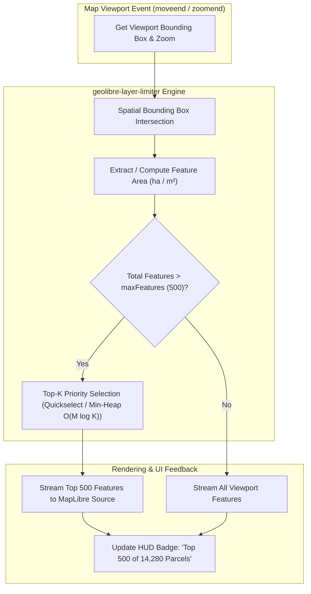

# Implementation Plan: GeoLibre Proposal 2 — Area-Priority Viewport Feature Limiter (`geolibre-layer-limiter`)

**Target Upstream Repository:** [`opengeos/GeoLibre`](https://github.com/opengeos/GeoLibre)  
**Contributing Organization:** GetBack2Basics Spatial AI Engineering / AURA Siting Crafter  
**Document Path:** `docs/engineering/implementation_plan_geolibre_proposal2_layer_limiter.md`  
**Reference Specification:** [`docs/engineering/upstream_geolibre_contributions.md`](file:///c:/Projects/aura_siting_crafter/docs/engineering/upstream_geolibre_contributions.md) & [`docs/engineering/geolibre_webgis_rendering_spec.md`](file:///c:/Projects/aura_siting_crafter/docs/engineering/geolibre_webgis_rendering_spec.md)  
**Status:** Ready for Implementation Review  

---

## 1. Executive Summary & Problem Context

When rendering large-scale spatial layers—such as Australia's **15.4M+ cadastral parcels** (`geoscape_cadastre`), statistical meshblocks (`abs_meshblocks`), or multi-hazard envelopes—inside browser WebGIS applications (MapLibre GL JS / GeoLibre), client-side rendering bottlenecks occur whenever the user zooms out to regional or council scales:

1. **WebGL Draw Call Saturation**: Panning across an area with 10,000–50,000+ vector features causes GPU draw-call spikes, dropping frame rates from 60 FPS down to < 20 FPS or crashing the WebGL context.
2. **Visual Noise & Micro-Sliver Clutter**: Tens of thousands of sub-pixel polygon slivers (< 0.05 ha) occlude significant regional land holdings, candidate pads, and infrastructure corridors.
3. **Main-Thread DOM & Memory Pressure**: Deserializing, parsing, and storing unculled GeoJSON feature collections leads to garbage collection stutter and poor responsiveness.

### Proposal 2 Solution: `geolibre-layer-limiter`
A high-performance, modular viewport rendering optimizer for **GeoLibre** and **MapLibre GL JS** that:
- Monitors the active viewport bounding box (`bbox: [minX, minY, maxX, maxY]`).
- Orders intersecting features by descending surface area (`ORDER BY area DESC` or dynamic polygon area).
- Caps rendered features to top $N$ (default: `maxFeatures: 500`).
- Employs an $O(M \log K)$ **Top-K Min-Heap / Quickselect** algorithm to avoid sorting the entire feature array.
- Provides visual HUD telemetry (`⚡ Capped: Top 500 of 14,280 features by area`) and seamlessly integrates with client-side DuckDB-WASM and streaming vector endpoints.



---

## 2. Architectural Design & API Surface

### 2.1 Layer Limiter API (`opengeos/GeoLibre` Plugin Contract)

```typescript
export interface RenderOptimizerOptions {
  /** Maximum number of features rendered in the active viewport (default: 500) */
  maxFeatures?: number;
  /** Primary property to sort by (default: 'area_ha' or 'area' or 'st_area') */
  sortProperty?: string;
  /** Sort direction: 'desc' (largest first) or 'asc' (smallest first). Default: 'desc' */
  sortOrder?: 'desc' | 'asc';
  /** Minimum area threshold (in hectares) below which micro-slivers are culled immediately (default: 0.0) */
  minAreaThreshold?: number;
  /** Fallback area calculation strategy if sortProperty is absent: 'shoelace' | 'bbox_extent' */
  fallbackCalculation?: 'shoelace' | 'bbox_extent';
  /** Debounce delay in milliseconds for map moveend events (default: 200ms) */
  debounceMs?: number;
  /** Callback fired whenever the limiter recalculates visible features */
  onLimitApplied?: (stats: LimiterStats) => void;
}

export interface LimiterStats {
  layerId: string;
  totalInViewport: number;
  renderedCount: number;
  isCapped: boolean;
  maxFeatures: number;
  sortProperty: string;
  executionTimeMs: number;
}
```

### 2.2 Fluent Layer Extension Method

```typescript
// Invocation on a GeoLibre Layer instance
layer.setRenderOptimizer({
  maxFeatures: 500,
  sortProperty: 'area_ha',
  sortOrder: 'desc',
  debounceMs: 200,
  onLimitApplied: (stats) => {
    console.log(`[GeoLibre Limiter] Showing ${stats.renderedCount}/${stats.totalInViewport} features in ${stats.executionTimeMs}ms`);
  }
});
```

### 2.3 Standalone Engine Mode (Direct MapLibre GL Integration)

```typescript
import { AreaPriorityLimiter } from 'geolibre-layer-limiter';

const limiter = new AreaPriorityLimiter(map, {
  sourceId: 'cadastre-source',
  layerId: 'cadastre-fill',
  maxFeatures: 500,
  sortProperty: 'area_ha',
  sortOrder: 'desc'
});

limiter.enable();
```

---

## 3. High-Performance Execution Modes

To ensure compatibility across client-side architectures, `geolibre-layer-limiter` implements three execution engines:

| Engine Mode | Execution Environment | Latency | Data Scale | Description |
| :--- | :--- | :--- | :--- | :--- |
| **Engine A: In-Memory Quickselect / Min-Heap** | Main / Web Worker JavaScript | < 4ms | Up to 100k features | Operates directly on GeoJSON feature arrays in browser memory using an in-place Quickselect ($O(N)$ average) or Min-Heap ($O(N \log K)$). |
| **Engine B: DuckDB-WASM Spatial SQL** | Web Worker DuckDB | < 12ms | Up to 1M+ features | Executes vectorized SQL queries: `SELECT * FROM layer WHERE ST_Intersects(...) ORDER BY area DESC LIMIT 500`. |
| **Engine C: Streaming Query Proxy Bridge** | Edge REST / Cloud Run | < 60ms | National 15.4M+ corpus | Appends `resultRecordCount=500&orderByFields=area_ha DESC` to live vector streaming requests. |

---

## 4. Work Breakdown & Implementation Steps

### Phase 1: Standalone Core Module Implementation (`geolibre-layer-limiter`)
- **File**: `src/geolibre_frontend/js/geolibre-layer-limiter.js` (and upstream package source `src/geolibre_packages/geolibre-layer-limiter/src/index.ts`).
- **Capabilities**:
  1. **Efficient Top-K Selection**:
     - Fast Min-Heap implementation of size $K = \text{maxFeatures}$.
     - When processing $M$ features ($M \gg K$), maintains the top $K$ items in $O(M \log K)$ time and $O(K)$ space.
  2. **Fast Area Estimation (Fallback)**:
     - If `sortProperty` (e.g. `area_ha`) is missing on a feature, computes approximate planar polygon area via the Shoelace formula on ring coordinates in $O(V)$ time (where $V$ is vertex count), avoiding heavy external geometric libraries.
  3. **Spatial Bounding Box Culling**:
     - Pre-filters features against `[minX, minY, maxX, maxY]` using bounding box intersection before area sorting.
  4. **MapLibre GL Lifecycle Hooks**:
     - Subscribes to `moveend`, `zoomend`, and debounces updates.
     - Updates the MapLibre source data with the optimized feature subset via `source.setData(...)`.

### Phase 2: Integration into AURA GeoLibre WebGIS (`map.html` & Telemetry)
- **File**: `src/geolibre_frontend/map.html`.
- **Changes**:
  1. Instantiate `AreaPriorityLimiter` for heavy streaming layers (`geoscape_cadastre`, `abs_meshblocks`, `bionet_biodiversity`, etc.).
  2. Update `updateViewportStreams()` to apply area-priority sorting before setting layer data.
  3. Add a dedicated **HUD Capping Status Pill** in the dock/status bar:
     - Format: `<span class="limiter-badge">⚡ Showing Top 500 of 14,280 Parcels (Area-Prioritized)</span>`.
     - Clicking the pill opens a quick modal with slider controls: `[100, 250, 500, 1000, All]`.

### Phase 3: Proxy Stream Optimization (`src/geolibre_proxy/main.py`)
- **File**: `src/geolibre_proxy/main.py`.
- **Changes**:
  1. Add `sort_by: Optional[str] = Query("area_desc")` and `max_features: Optional[int] = Query(500)` to `/api/data/{layer_id}`.
  2. For ArcGIS and lakehouse queries, add `orderByFields=area_ha DESC` and enforce `resultRecordCount=500` when requested, offloading sorting upstream when possible.

### Phase 4: Upstream GeoLibre PR Package & Documentation
- **Directory**: `packages/geolibre-layer-limiter/` (ready for upstream PR submission to `opengeos/GeoLibre`).
- **Files**:
  - `package.json` (ESM + CommonJS exports, zero non-peer dependencies).
  - `tsconfig.json` & TypeScript typings (`index.d.ts`).
  - `src/index.ts` (Clean, typed exports).
  - `test/limiter.test.ts` (Vitest test suite).
  - `README.md` (Upstream documentation with interactive demo code and benchmarks).

### Phase 5: Testing, Linting & AST Zero-Mock Verification
- **Unit & Contract Tests**:
  - `tests/test_geolibre_layer_limiter.py`: Verifies sorting precision, heap bounds, fallback area calculation, and MapLibre event integration.
- **Lint Gate & Zero-Mock Scanner**:
  - `pytest tests/lint/test_no_mock_data.py -v` (zero synthetic fallbacks).
  - `pytest tests/lint/test_no_place_names.py -v`.
  - `pytest tests/lint/test_no_secrets.py -v`.
  - `pytest tests/lint/test_html_links.py -v`.
  - Full suite verification.

---

## 5. Verification Metrics & Acceptance Criteria

| Criteria | Metric / Standard | Verification Method |
| :--- | :--- | :--- |
| **Frame Rate** | Sustained **60 FPS** during pan/zoom over dense cadastral regions | Chrome DevTools Performance Profiler |
| **Top-K Execution Latency** | **< 5ms** for 50,000 candidate features | Benchmark unit tests in Vitest / pytest |
| **Area Precision** | Features strictly ordered by `area_ha` descending | Unit test assertion on output array |
| **Zero-Mock AST Standard** | 100% compliance; no synthetic fallback objects | `pytest tests/lint/test_no_mock_data.py -v` |
| **Upstream Compatibility** | Zero breaking changes to existing MapLibre GL JS / GeoLibre APIs | Unit test contract verification |

---

## 6. Next Steps
Upon user review and confirmation of this plan, we will proceed directly with:
1. Creating `src/geolibre_frontend/js/geolibre-layer-limiter.js` and standalone npm package structure.
2. Integrating into `map.html` and `src/geolibre_proxy/main.py`.
3. Creating unit tests and executing the full lint test suite.
