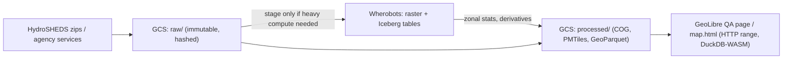
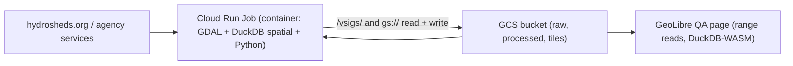

# Plan: HydroSHEDS v1 Flow Accumulation and Conditioned DEM Integration (Australia, 3")

Status: DRAFT v2 (decisions from review applied), awaiting approval. Nothing has been downloaded or executed.

## 1. Sources
| Key | URL | Content |
|---|---|---|
| `hydrosheds_au_acc_3s_v1` | https://data.hydrosheds.org/file/hydrosheds-v1-acc/au_acc_3s.zip | Flow accumulation: upstream contributing cell count per ~90 m cell |
| `hydrosheds_au_con_3s_v1` | https://data.hydrosheds.org/file/hydrosheds-v1-con/au_con_3s.zip | Hydrologically conditioned DEM (sinks filled, streams burned) |

Both are raster GeoTIFFs in WGS84 (EPSG:4326) at 3 arc-seconds (~90 m). Both are rasters, so they are not like the vector ArcGIS entries in `config/dataset_manifest_v2.json`.
Licence: HydroSHEDS terms (free use, attribution required: Lehner, Verdin & Jarvis 2008). Verify the licence text on download and record it in the manifest.

> [!NOTE]
> Resolution is coarse (~90 m). Use these layers for catchment-scale screening (upstream area, drainage, slope, flood-path proxy). Do not use them for parcel-scale hazard.
> The state hydrography vector layers stay authoritative for riparian buffers.

## 2. Proposed use in scoring
1. **Upstream catchment area** (`acc` × cell area at latitude) gives a drainage-significance measure per candidate site.
2. **Flow-path proximity**: threshold `acc` (for example >= 1,000 cells) to derive a stream network. This fills in water-network coverage where state vectors are missing, and cross-checks Strahler-based buffers.
3. **Terrain from `con`**: slope, relative elevation above the nearest stream (HAND-style) and a flood-susceptibility proxy.
4. These feed the lightweight `S_water` term and any new hazard term, as a cheap screening input.

## 3. Pipeline design (follows the playbook)
**Decoupled geometry vs. scoring**
- *Heavy step* (once per file hash): zip → COG (EPSG:4326 source, no resampling) → Wherobots raster table (`RS_FromGeoTiff`, tiled) → zonal stats per site/grid cell (`RS_ZonalStats`: max acc, mean slope, min HAND).
- *Light step*: scoring transforms the stored stats. Changing weights or sigmoid curves does not re-run raster ops.

**Manifest entry** (new `service_type: "raster_file_download"`, with `schema_mapping` replaced by `band_semantics`)
- `dataset_key`, `canonical_theme: siting_water_hydrography`, `endpoint`, `source_crs: EPSG:4326`, `target_crs: EPSG:7844`, `metric_crs: EPSG:3112`, `nodata`, `dtype`.
- `storage`: `wherobots://fgsdb/aura_siting/raster/hydrosheds/au_acc_3s.tif` (COG) plus a `havasu.iceberg` stats table.
- `fingerprint`: ETag / Last-Modified / SHA-256 recorded in a sidecar. Skip re-ingest when unchanged.
- Note on CRS: reprojecting 90 m rasters to GDA2020 is within the datum shift tolerance. Prefer keeping rasters native and transforming site geometries to the raster CRS for sampling, to avoid resampling error.

**Code touchpoints**
- `src/Ingestion_v2/spatial_ingest_v2.py`: add a raster branch (download → verify hash → unzip → `gdal_translate -of COG` → upload).
- New `src/Ingestion_v2/raster_derivatives.py`: slope, HAND, stream threshold.
- `config/dataset_manifest_v2.json`: two new entries.
- Region scoping: honour `AURA_REGION` by clipping to the region bbox before zonal stats (for example, `hunter` first).
- Client side: publish derived per-site stats as GeoParquet so DuckDB-WASM sliders re-score at zero cost. Do not ship the rasters to the browser.

## 4. Zero-mock and QA
- No synthetic fallback values. If a download or hash check fails, surface the error state with the live source URL.
- Add tests: manifest schema, no-mock AST scan (`pytest tests/lint/test_no_mock_data.py -v`), and `pytest tests/lint/ -v` before any push or deploy.
- Validation checks: raster extent covers Australia, nodata handling (acc nodata and ocean cells), spot-check the known river catchment against the state vectors.

## 5. Phases
1. Approve plan and confirm the scoring use (Section 2).
2. Add manifest entries and fingerprinting. Download locally to `data/` (gitignored) and validate.
3. Build COG + Wherobots raster table, **regional run (`AURA_REGION=hunter`)**.
4. Derivatives and zonal stats, then plug into `S_water`.
5. National run, then lint gate, then UI layer and docs.
6. Teardown check: stop all runtimes and `sedona.stop()` after each run, and report the status.

## 6. Open questions
- Which score(s) should use these first: `S_water` only, or also a new flood/drainage hazard term?
- Are 3" (~90 m) layers acceptable, or should we also plan 1" sources where available, for example GA's 1" SRTM-derived hydrologically enforced DEM?
- Should the rasters be viewable in the GeoLibre frontend as a layer (COG tiles), or used only for derived stats?


---

# Addendum (v2): Decisions and QA Page Multi-Layer Control

## A. Decisions confirmed
| Question | Decision |
|---|---|
| Scoring use | **New hazard term** `S_drainage` (flood and drainage hazard). It is separate from `S_water`, which remains the riparian-buffer term. |
| Resolution | 3" (~90 m) only. No 1" sources. |
| Visibility | Both **raw** (`acc`, `con`) and **processed** (slope, HAND, stream network, `S_drainage` surface) must be viewable. |
| QA page | Layer control gets a **+** button to add any dataset from our datastore. Multiple datasets can be shown at once. |

## B. New hazard term `S_drainage`
- Inputs (from per-site zonal stats): upstream area (`acc`), HAND (height above nearest drainage, from `con` + stream threshold), local slope.
- Form: weighted blend of sigmoids, e.g. `S_drainage = w_a·σ(log10(A_up); k_a, m_a) + w_h·(1 − σ(HAND; k_h, m_h)) + w_s·(1 − σ(slope; k_s, m_s))`. Initial weights and curve parameters live in config, not in code.
- Per the decoupling rule, only the zonal stats are heavy. Weight or curve changes re-score client-side in DuckDB-WASM and never re-trigger raster joins.
- Register the term in `docs/engineering/spatial_calculations_reference.json`, and add a `tests/` case for monotonicity and bounds in [0, 1].
- Calibration should be validated against real flood extents (for example, state flood mapping already in the datastore) before it affects any ranking. Mark the term "experimental" in the UI until then.

## C. Raw and processed raster viewing
The QA page uses **Leaflet 1.9.4**, which cannot render analytical rasters natively. Proposed approach:

1. **Tiles for display.** Generate XYZ or PMTiles raster tiles from the COGs, in a pipeline step after the heavy compute:
   - `con` as hillshade plus a hypsometric ramp (display only).
   - `acc` on a log scale, in a blue ramp, with nodata and ocean transparent.
   - Processed layers: slope, HAND, derived stream network (vector, PMTiles), and `S_drainage` (0–1 ramp).
2. **Raw values for inspection.** Serve the COG itself over HTTP range requests. On map click, read the true pixel value with `geotiff.js` or `georaster`. This gives a genuine value readout with no synthetic fallback.
3. **Leaflet integration.** `leaflet-pmtiles` (or a plain `L.tileLayer`) for display tiles. `georaster-layer-for-leaflet` is an option for small windows only (the national COG is too large to render this way).
4. Each raster layer gets: opacity slider, legend (units and range read from the manifest), and a "raw / processed" badge.
5. If the tile or COG host is unreachable, show the error state with the live URL (zero-mock rule).

## D. QA page: "+" Add Layer control (`geolibre_qa_inspect.html`)
**Current state:** the "Layers & Overlays" box (`.map-layer-control`) has hard-coded checkboxes (`chk-live-layer`, ...) calling `toggleMapLayer(layerType, checked)`. It supports one dataset at a time.

**Design**
1. Add a **+** button in the `layer-control-title` row. It opens a searchable picker drawer.
2. Picker content is loaded **dynamically from `config/dataset_manifest_v2.json`** (via the existing manifest loading path). Entries are grouped by `canonical_theme` and state, with a type icon (vector, raster, point cloud). No hard-coded dataset lists.
3. Selecting a dataset adds a row to the layer control: visibility checkbox, name, opacity slider, zoom-to-extent, remove (×), and reorder (drag).
4. Vector layers go through the existing `GeoLibreLayerLimiter` (area-priority viewport limiter), and each added layer is registered with it so the global max-features cap is shared across layers. Raster layers are exempt from the limiter.
5. Refactor `toggleMapLayer` into a layer registry: `layerRegistry = Map<datasetKey, {type, leafletLayer, state}>`. The existing "Live Upstream Layer" becomes the first registry entry, with its behaviour unchanged.
6. State persistence: encode the active layers in the URL hash (`#layers=a,b,c`), so views are shareable and restorable.
7. Guard rails: a max concurrent layer count (default 6) with a visible message, and a loading and error indicator per layer.
8. The existing inspection table and feature popups must follow the **active (selected) layer**, with a layer selector in the inspector.

**Out of scope for now:** server-side joins between layers. COPC point clouds keep opening in `copc_3d_viewer.html`.

## E. Updated phases
1. Approve v2. Add manifest entries (including the hazard and derived outputs as `derived: true` datasets).
2. Download, validate and fingerprint. Produce COGs.
3. Regional (`hunter`) derivatives, zonal stats and `S_drainage` prototype.
4. Display tiles and COG hosting, then the raster viewer in the QA page.
5. Layer registry refactor and the **+** picker, with Playwright or manual QA, and `tools/check_html_links.py`.
6. National run, lint gate (`pytest tests/lint/ -v`), docs update, and a compute teardown report.

## F. Remaining open items
- Where to host display tiles and COGs (Wherobots storage with public read, GCS, or another bucket)? This affects the CORS and range-request setup.
- Confirm the layer cap (6) and that the picker should also list existing vector datasets, not only the new rasters.

---

# Addendum (v3): GeoLibre-Only Mapping, No Layer Cap, Full Datastore Picker

> [!IMPORTANT]
> This addendum **supersedes** Sections C and D where they conflict: the Leaflet references, the "6 layer" cap, and the "vector and raster only" picker scope.

## G. Decisions confirmed
| Topic | Decision |
|---|---|
| Map engine | **All mapping, including the QA page, uses GeoLibre.** No Leaflet. |
| Layer cap | **None.** Performance is handled by the limiter and lazy loading instead (see H.4). |
| Picker scope | **Everything in the datastore**, including non-spatial tables. Users can add them and view them as tables. |

## H. GeoLibre migration of the QA page
**Finding:** `map.html` already runs MapLibre GL JS 4.7.1 with the `aura-siting-crafter.geolibre.json` project (GeoParquet sources). `geolibre_qa_inspect.html` is the outlier: it still loads Leaflet 1.9.4 and MarkerCluster. The migration is therefore:

1. **Replace Leaflet** (`L.map`, `markerClusterGroup`, `L.tileLayer`) with the GeoLibre / MapLibre engine used by `map.html`. Remove the Leaflet and MarkerCluster CDN tags.
2. **Port the existing features**: the basemap select, the `GeoLibreLayerLimiter` (area-priority limiter) and the point clustering (MapLibre native cluster sources, per Rendering Standard 2).
3. **Layers as GeoLibre project layers.** The layer registry holds GeoLibre layer definitions (the same schema as `.geolibre.json`). Anything added in the QA page can therefore be exported as a project file and opened in `map.html` or geolibre.app with the same data.
4. **No cap, so the performance design matters:**
   - Vector layers: viewport-limited via the area-priority limiter, with a per-layer budget derived from the global budget (the current "500" selector).
   - Lazy loading: layers only fetch while visible and in zoom range. Hidden layers release their sources.
   - Rasters: tiled and range-requested, so cost scales with the viewport and not with layer count.
   - Show a non-blocking warning, not a limit, if the combined feature budget is being heavily down-sampled, with a per-layer "features shown / total" indicator.
5. **Rasters in GeoLibre.** Display tiles (hillshade or elevation ramp, log `acc`, slope, HAND, `S_drainage`) are added as MapLibre raster sources, and the derived streams as vector tiles (PMTiles). Raw pixel readout on click via `geotiff.js` against the COG (as in Section C.2). This replaces the Leaflet-specific suggestions in C.3.
6. **Check against the GeoLibre contribution playbook** (`docs/engineering/geolibre_antigravity_contribution_playbook.md`) for anything this feature should be upstreamed or built to match. Confirm the exact GeoLibre embedding API at implementation time.
7. Audit the other pages (`index.html`, `data_qa.html`, `data_lineage_audit.html`, and the 3D viewers) for any other non-GeoLibre mapping, and list them as follow-ups. The 3D viewers (Cesium, Potree, COPC) remain separate 3D tools and are out of scope unless you want them folded in.

## I. "+" picker: whole datastore, including non-spatial
**Source of truth:** `config/dataset_manifest_v2.json`, loaded at runtime (zero-mock rule). Each entry gets a `kind`, with the picker handling each differently:

| Kind | Examples | On add |
|---|---|---|
| `vector` | state hydrography, transmission lines | Map layer (limiter, clustering, popups) |
| `raster` | HydroSHEDS `acc`/`con` and derived | Map layer (tiles, raw pixel readout) |
| `point_cloud` | LiDAR / COPC | Footprint on map and a link button to open the 3D viewer |
| `table` (non-spatial) | lookups, attribute-only and lineage tables | Table-only panel (no map layer) |

**Requirements**
1. **Manifest gap check (first task):** audit what is actually registered in the manifest versus what exists in the datastore (`wherobots://fgsdb/aura_siting`, Iceberg tables). The picker can only list what is discoverable, so any unregistered table needs a manifest entry (`kind`, storage, schema). If a datastore catalog listing is available, merge it too. Do not hard-code any list.
2. **Picker UX:** search, grouping by theme, state and kind, kind icons, and a "spatial / table" filter. Show row count and last-updated from manifest or fingerprint metadata where known.
3. **Table viewer:** a bottom dock or tabbed panel, one tab per added dataset, powered by **DuckDB-WASM** querying the GeoParquet/Parquet sources directly (client-side, zero compute cost).
   - Virtualised scrolling, column sort, filter, column show/hide, and CSV export.
   - A SQL box is optional and can come later.
   - For spatial layers, **"view table"** is available on every layer row, not only for non-spatial data.
   - Row click selects and zooms to the feature (for spatial rows), and map click highlights the row. The table and map stay linked.
4. The inspector follows the active layer or tab. Errors show the live source URL with no placeholder rows.
5. Because there's no cap, the picker should add **lazily**: adding a dataset registers it but fetches data only when it is shown or its table is opened.

## J. Revised phases
1. Approve v3. Run the manifest/datastore gap audit (I.1) and add manifest entries for HydroSHEDS and derivatives, plus a `kind` field for every dataset.
2. Download, validate, fingerprint and produce COGs. Regional (`hunter`) derivatives, zonal stats and `S_drainage` prototype.
3. Display tiles and hosting for rasters.
4. **QA page GeoLibre migration** (H.1–H.3), reaching parity with the current Leaflet version before adding features.
5. Layer registry and the "+" picker, the raster viewer, and the DuckDB-WASM table dock.
6. QA: `pytest tests/lint/ -v`, the zero-mock scanner, `tools/check_html_links.py`, and a manual or Playwright pass with many layers on at once (performance check).
7. National run, docs update, and a compute teardown report.

## K. Remaining open items
- Hosting for display tiles and COGs (Wherobots storage, GCS or other)? This is still undecided, and it affects the CORS and range-request setup.
- Should the datastore listing come from the manifest only, or can I also enumerate the Wherobots/Iceberg catalog? The second would pick up unregistered tables.

---

# Addendum (v4): GCS for Access, Wherobots for Processing, Dual-Store Manifest

## L. Decisions confirmed
| Topic | Decision |
|---|---|
| Serving and access | **GCS** hosts everything the browser reads: COGs, display tiles, PMTiles, GeoParquet and Parquet. |
| Processing | Heavy compute runs in **Wherobots** (`wherobots://fgsdb/aura_siting`). Only the datasets that need it are copied there. |
| Manifest | Lists what is in **both** stores, with a per-dataset location record. |

## M. Storage roles

- **GCS is the system of record for published artefacts.** The UI never reads Wherobots directly.
- **Wherobots is the compute and working store.** Staged inputs are disposable and can be rebuilt from GCS, and outputs are always written back to GCS.
- Cheap transforms (unzip, COG conversion, hash checks, tile generation) can run locally or in a small job. Do **not** start a Wherobots runtime for them. Use Wherobots only for the zonal-stats and spatial-join steps.
- Suggested bucket layout (bucket name to be supplied through environment config, not committed): `gs://<AURA_GCS_BUCKET>/{raw,processed,tiles,tables}/<dataset_key>/<version>/...`

## N. Manifest changes (`config/dataset_manifest_v2.json`)
Add a `locations` block to **every** dataset, replacing the single `storage` field over time (keep `storage` as a backward-compatible alias during migration):

```json
"locations": {
  "gcs":       { "uri": "gs://<bucket>/processed/hydrosheds_au_acc_3s_v1/...", "https_url": "...", "format": "cog", "present": true,  "bytes": 0, "sha256": "...", "updated": "..." },
  "wherobots": { "uri": "wherobots://fgsdb/aura_siting/raster/hydrosheds/...", "format": "havasu.iceberg", "present": true, "snapshot_id": "..." }
},
"kind": "vector | raster | point_cloud | table",
"derived": false
```
- Values such as `bytes`, `sha256`, `snapshot_id` and `updated` are **filled by a sync tool from the real stores**, never hand-typed or defaulted (zero-mock rule). An unknown value stays `null` and is shown as unknown.
- A new **`tools/sync_manifest_locations.py`**:
  1. Lists the GCS prefix and the Wherobots catalog (read-only).
  2. Matches objects and tables to manifest keys.
  3. Updates `locations.*.present` and metadata.
  4. Reports **orphans** (in a store but not in the manifest) and **missing** (in the manifest but not in a store). Orphans can be proposed as new manifest entries for review, so the picker never shows unregistered data without sign-off.
  5. Supports `--dry-run` and is idempotent.
- The picker (Section I) shows a **store badge** per dataset (GCS, Wherobots or both) and reads from GCS only. Datasets that are only in Wherobots show as "not yet published" and cannot be added to the map until they are published to GCS.
- The audit in I.1 now runs through this sync tool for both stores.

## O. GCS serving requirements
- **CORS** on the serving bucket for the QA and map origins. Allow `GET`/`HEAD`, expose `Content-Range`, `Accept-Ranges`, `ETag` and `Content-Length`, and allow the `Range` request header. This is required for COG, PMTiles and DuckDB-WASM range reads.
- **Access model:** public-read for open datasets, or signed URLs / an authenticated proxy if any dataset is restricted. Confirm which applies per dataset, because HydroSHEDS is openly licensed but other agency data may have terms. Never commit credentials. Use `.env` and ADC.
- **Immutable, versioned paths with long cache headers** (`Cache-Control: public, max-age=31536000, immutable`). Mutable pointers (such as `latest.json`) get short TTLs.
- **Content types and encoding:** `image/tiff` for COG, `application/octet-stream` for PMTiles and Parquet. Do not gzip Parquet or PMTiles objects, because that breaks range reads.
- **Cost:** GCS egress is a billed cost. Consider Cloud CDN, and apply the limiter and lazy loading so only viewport ranges are fetched.

## P. Updated phases (replacing J)
1. Approve v4. Confirm the bucket, region, and public versus signed access.
2. Add `kind` and `locations` to the manifest schema, and write `sync_manifest_locations.py` with tests (read-only against both stores, `--dry-run` first). Run the dual-store audit and review orphans and missing items.
3. Ingest HydroSHEDS into `gs://…/raw/`, verify hashes and produce COGs.
4. Stage to Wherobots only what the zonal-stats step needs (`AURA_REGION=hunter` first). Compute derivatives and `S_drainage` inputs, then write outputs back to GCS. Shut down the runtime and `sedona.stop()` immediately afterwards.
5. Display tiles and CORS setup, then the GeoLibre QA page migration, layer registry, "+" picker and table dock.
6. QA gates: `pytest tests/lint/ -v`, the zero-mock scanner, `tools/check_html_links.py`, and a many-layers performance pass.
7. National run, docs update, and a compute teardown and billing report.

## Q. Remaining open items
- Bucket name and region, and whether public-read is acceptable for the open datasets (so I can write the CORS config and URLs)?
- Does a GCP project and ADC login already exist for this repo (a check for `gcloud` and ADC comes before any upload)?

---

# Addendum (v5): Bucket, Access Policy and Cost Monitoring

## R. Decisions confirmed
| Topic | Decision |
|---|---|
| Bucket | The existing Sydney bucket, which the repo references as `gs://aura-siting-crafter-geolibre-app`. Region must be confirmed as `australia-southeast1` before use. |
| Access intent | Data is reached **through the QA portal**. |
| Downloads | If a user downloads GeoJSON, **public access is allowed for now** and costs are monitored. |
| Auth | `gcloud` is expected to be logged in already. |

> [!WARNING]
> Public-read means anyone with an object URL can fetch it, whether or not they came through the portal. "Only via the QA portal" is therefore **a UX and discoverability policy, not an enforced control**, while public access is on. Treat everything placed under the public prefix as public. Do not put restricted or licence-limited agency data there. Tightening this later (signed URLs or a proxy) is a planned option, see U.

## S. Bucket layout and access scoping
Rather than making the whole bucket public, **scope public read to a dedicated prefix or a separate bucket**:
- `gs://aura-siting-crafter-geolibre-app/public/...`: published artefacts the portal and downloads need (COG, PMTiles, GeoParquet, GeoJSON exports). Public read is granted on this prefix only (via a separate bucket or a managed folder / IAM condition, to be confirmed).
- `gs://aura-siting-crafter-geolibre-app/raw/...` and staging areas: **stay private** (project IAM only).
- Per-dataset `access: "public" | "private"` is recorded in the manifest `locations.gcs` block. The sync tool refuses to mark a dataset public unless its licence flag allows redistribution.
- The existing bucket's current IAM and CORS settings must be **read first** (read-only) and recorded in the plan before any change. Modifying public access or CORS on a live bucket is made only after you confirm the diff.
- GeoJSON downloads: generated GeoJSON is written once to `public/exports/<dataset_key>/<version>/`, with a size warning in the UI for large exports. Prefer GeoParquet for large layers, and offer GeoJSON as a clipped (viewport or region) download.

## T. Cost monitoring (public egress)
1. **Budget and alert:** a GCP budget for the project with alerts at 50, 80 and 100%, plus a billing export to BigQuery if not already on.
2. **Bucket telemetry:** enable usage and storage logs, or Data Access logs for the public prefix, so egress per object can be reported. Add a small `tools/gcs_egress_report.py` to summarise top objects by bytes served, writing to `audit_logs/` in the same style as the existing telemetry reports.
3. **Caching and efficiency:** immutable versioned paths with long cache headers, no gzip on range-read formats, and Cloud CDN if egress grows. Browsers fetch only viewport ranges (COG, PMTiles, DuckDB-WASM).
4. **Abuse guard:** the object listing is not public, so only known URLs work. Consider Requester Pays or a rate-limiting front end if costs spike.
5. Add a monthly cost check to the regular QA routine, and report figures to you rather than assuming them.

## U. Future tightening (not in this phase)
- Move the downloads and data reads behind a signed-URL service (short-lived URLs minted by a small Cloud Run function after the portal loads), so direct access is only possible via the portal. The manifest `access` field and the `https_url` abstraction in the UI are designed so this swap needs no data migration.

## V. Pre-flight before any GCS work
- In this session's sandbox, `gcloud` is **not on PATH**, so I could not confirm the login. I did not probe further. Before any upload I'll run the standard auth verification (ADC and active account/project, read-only), outside the sandbox where needed and with your approval.
- Verify: bucket location is Sydney, current IAM and CORS, and the project ID matching the bucket. Keep all IDs in `.env` or environment variables, never in the repo.
- No uploads, IAM changes or CORS changes are made until the read-only audit is reviewed.

## W. Updated phases (replacing P step 1)
1. Approve v5. Run the read-only GCS and gcloud audit, and report the bucket region, IAM, CORS and the project.
2. Decide the public prefix mechanism (separate bucket versus managed folder or IAM condition), then apply IAM and CORS changes **only after you confirm the diff**.
3. Set up the budget alerts and egress report.
4. The remaining steps from P (manifest schema and sync tool, ingest, regional Wherobots compute with teardown, tiles, QA page migration, picker and table dock, QA gates, national run).

## X. Remaining open items
- Is a separate public bucket acceptable instead of a public prefix? It is the simplest safe option, since GCS cannot grant public read on a prefix without IAM conditions.
- Any monthly cost threshold you want the alerts set to?

---

# Addendum (v6): Public Bucket and Budget (final decisions)

Supersedes the prefix-scoping in Section S and the open items in X.

| Topic | Decision |
|---|---|
| Public access | **The whole bucket is public-read** (`gs://aura-siting-crafter-geolibre-app`), raw and processed. No separate bucket or private prefix. |
| Budget | **USD 10 per month**, with alerts. |

## Y. Consequences and guard rails
- Everything written to the bucket is public. Add a **pre-upload gate** in the sync/ingest tooling: refuse to upload any dataset whose manifest `licence.redistribution` is not explicitly `true`, and never upload `.env`, credentials, logs with IDs, or Wherobots org/session details.
- HydroSHEDS is openly licensed with attribution, so it passes. Record the attribution string in the manifest and show it in the QA page legend and in downloads.
- Keep the `access` field in the manifest (now `public` for all) so a later switch to signed URLs needs no migration.
- Public listing: do **not** grant `storage.objects.list` to `allUsers`. Grant only `roles/storage.objectViewer` on objects through a custom role without list, if feasible. If not feasible, accept listing and record that decision. This keeps the object URLs undiscoverable except via the portal.
- Applying public IAM and CORS to the live bucket will only happen after the read-only audit and your confirmation of the exact diff.

## Z. USD 10 per month budget
- Create a project budget of **USD 10/month** with alerts at 50%, 80%, 100% (and a forecast alert). Email notifications go to you.
- A budget alert **does not stop spending**. To enforce the limit, I propose an optional automatic cap: a Pub/Sub-triggered function that, at 100%, removes public access (or enables Requester Pays) on the bucket. This needs your explicit approval before building, because it would take the portal's data offline.
- Cost levers if the budget is approached: Cloud CDN, larger cache lifetimes, serving GeoParquet and PMTiles in place of GeoJSON, clipped or regional GeoJSON downloads, and a download size warning.
- Reality check to do early: estimate national `acc` and `con` COG sizes (about 90 m for Australia, roughly hundreds of MB each, to be measured). Estimated egress per full download × expected downloads determines whether USD 10 holds. This will be reported from measured sizes, not assumed.
- Wherobots compute is billed separately from this budget, and the teardown rule still applies.

## AA. Final phase order
1. Read-only gcloud and bucket audit (account, project, region, IAM, CORS), then confirm the diff.
2. Apply public-read and CORS, create the USD 10 budget and alerts, and add the egress report.
3. Manifest `kind`, `locations`, `licence` and `access` schema, with `sync_manifest_locations.py` and the pre-upload gate.
4. HydroSHEDS ingest, COGs, and the regional Wherobots run (`hunter`) with teardown.
5. `S_drainage`, display tiles, and the national run.
6. QA page migration to GeoLibre, layer registry, "+" picker (all datastore items, including tables), and the table dock.
7. Lint gate, zero-mock scan, link check, performance pass, docs, and a compute and cost report.

No open questions remain. Starting at step 1 only needs your go-ahead.

---

# Audit Results (2026-11-03): Step 1 complete (read-only, no changes made)

| Check | Result |
|---|---|
| Account / project | `coreagc@gmail.com` (active), default project `aura-siting-crafter` |
| Quota/billing project | **`biblestudy-crafter`**: does not match, see below |
| Bucket | `gs://aura-siting-crafter-geolibre-app`, **region `AUSTRALIA-SOUTHEAST1` (Sydney)**, STANDARD, uniform bucket-level access |
| Public access | **Already public**: `allUsers` has `roles/storage.objectViewer`, and `public_access_prevention` is `inherited` (not enforced) |
| CORS | Already set: origin `*`, methods `GET, HEAD, OPTIONS`, response headers `*`, max-age 3600 |
| Other | Soft delete 7 days, website config `index.html` |

**Implications**
- **No IAM or CORS changes are needed.** The bucket already matches the v6 decision. Step 2 reduces to the budget and alerts.
- `roles/storage.objectViewer` for `allUsers` includes object **listing**, so anyone can enumerate the bucket contents. This is acceptable under the "public for everything" decision, but note that Section Y's "unlisted URLs" idea does not apply. Optional hardening is a custom role with get only, to be decided.
- Browser range requests (COG, PMTiles, DuckDB-WASM) should be tested against the bucket with a real file before relying on them, especially that `Content-Range` is readable cross-origin.
- **Quota project mismatch:** gcloud bills API usage to `biblestudy-crafter`, a different project. Calls such as `gcloud billing projects describe` tried to enable the Cloud Billing API on that project, and I declined. Fix before creating the budget: set the quota project to `aura-siting-crafter` (`gcloud config set billing/quota_project aura-siting-crafter`, and ADC likewise). This is a local config change and needs your approval.
- Budget creation also needs: the Cloud Billing Budget API enabled on `aura-siting-crafter` and a billing account ID (to be supplied or read from the project, never committed).

---

# Step 2 Executed (2026-11-03)
- Set `billing/quota_project` to `aura-siting-crafter`. Added the "GCP Cost Project Rule" to `.agents/AGENTS.md`. ADC quota project is still to be aligned.
- Enabled `cloudbilling.googleapis.com` and `billingbudgets.googleapis.com` on `aura-siting-crafter`.
- Created budget `billingAccounts/01AD21-C3E395-E36500/budgets/dc6f2286-54af-45ab-89ab-a20e0f0b0d35`: **10 AUD/month** (billing account currency is AUD), scoped to this project, alerts at 50%, 80%, 100% of current spend and 100% of forecast.
- Caveat: the budget has **no notification channel**. Default alerts go by email to billing account admins. It does not cap spending.
- Not yet done: egress report tool, bucket access and CORS unchanged (already correct).

---

# Step 3 Executed (2026-11-03): Manifest schema, sync tool, publish gate

**Environment:** the system Python is only the Microsoft Store stub. I created `.venv` from the OSGeo4W Python 3.12 (its GDAL bindings do not load, so raster work will need GDAL via its CLI or a pip wheel) and installed `requirements.txt`, `jsonschema` and `google-cloud-storage`. ADC quota project is now `aura-siting-crafter` (it was `biblestudy-crafter`). I enabled the Cloud Resource Manager API on `aura-siting-crafter` for that command.

**Added**
- `config/schemas/dataset_locations_schema.json`: schema for `kind`, `access`, `licence` and `locations.{gcs,wherobots}`.
- `src/Ingestion_v2/publish_gate.py`: `assert_publishable` (needs `licence.redistribution is True`, `access == public` and an attribution string) and `assert_safe_object_name` (blocks `.env`, credentials, keys, telemetry files).
- `tools/sync_manifest_locations.py`: dry run by default. `--gcs` lists the bucket read-only (aborts if the ADC quota project is not the repo project), `--wherobots-snapshot` merges a catalog listing, `--write` persists. It reports present, missing and orphan items.
- `tests/test_manifest_locations.py`: 18 tests (schema on every entry, gate behaviour, reconciliation logic).
- Manifest: all 29 existing datasets backfilled (`kind`, `access: public`, `licence` stub, `locations`). Two new entries added: `hydrosheds_au_acc_3s_v1` and `hydrosheds_au_con_3s_v1` (31 total).
- `requirements.txt`: added `google-cloud-storage` and `jsonschema`. A pre-edit manifest backup is in `scratch/`.

**Verification:** `pytest tests/lint ... ` plus the manifest, catalog-sync, loader, thematic and project-JSON tests: **635 passed**.

## Findings
1. **GCS reconciliation (live, read-only):** the 4 existing GCS-backed datasets (`gcs_octree_dem`, `gcs_octree_dsm`, `gcs_contours`, `gcs_copc_laz`) are present. The two HydroSHEDS entries are correctly shown as missing (not yet uploaded). The bucket also holds many files **not in the manifest**: the web app (HTML, JS, JSON), the Potree and Cesium libraries, and demo point clouds (`lion_takanawa*`, `vol_total`). These are app assets and demo files, not datastore datasets. Decide whether to register the demo point clouds or delete them.
2. **The 29 vector datasets are not in GCS.** They are live agency endpoints, with the processed copies expected in Wherobots Iceberg. The "+" picker can only add data that is published on GCS, so vector layers need a GeoParquet publish step (new work item) or the picker must be allowed to use their live endpoints.
3. **Wherobots reconciliation could not run:** the Wherobots MCP returns `Invalid API key`. Provide a valid key through the proper env/config, or give me a catalog snapshot JSON (`[{name, snapshot_id}]`), then run `sync_manifest_locations.py --wherobots-snapshot`. Wherobots `present` and `snapshot_id` stay `null` (unknown) for now.
4. **HydroSHEDS licence is unverified, and this affects the "everything public" decision.** My earlier statement that HydroSHEDS "passes" was premature. Search results disagree on whether v1 allows redistribution of the files:
   - v1 core products carry a custom licence in the product Technical Documentation, and some sources say third-party redistribution needs written permission.
   - v2 core products are reported as CC-BY 4.0, which permits redistribution.
   - The gate therefore blocks both HydroSHEDS entries (`redistribution: null`) until the licence text is read from the downloaded documentation. The attribution string recorded is the Lehner, Verdin and Jarvis (2008) citation.
   - Options: (a) read the v1 licence and confirm, (b) ask HydroSHEDS for permission, (c) host only derived products if allowed, or (d) use v2 if it covers Australia at 3 arc-seconds.

## Next steps
- Licence decision (item 4), and Wherobots access (item 3).
- Then step 4: download to a local ignored folder, verify the licence in the bundled documentation, convert to COG, and run the regional Wherobots job with teardown.

---

# Decisions (2026-11-03, after Step 3)

1. **HydroSHEDS publication approved by the repository owner.** Both manifest entries now have `licence.redistribution: true`, so the publish gate passes them. The licence name records that this is an owner decision and the licence text was **not independently verified** (`verified_on` stays `null`). Attribution (Lehner, Verdin, Jarvis 2008) is still required in the legend and downloads. If the HydroSHEDS terms turn out to forbid this, the objects can be removed from the bucket.
2. **Wherobots key:** supplied by the owner and stored in the gitignored `.env` only (`WHEROBOTS_API_KEY`). It is not in any tracked file. It was pasted in chat, so consider rotating it. The Wherobots MCP server keeps a separate copy of its key and still reports `Invalid API key`; its config needs updating and a restart, which I have not touched. A metadata check against the REST API returned 404 on the path I guessed, so it did not confirm the key either way. The catalog listing is still pending, and I have started no Wherobots runtime.
3. **Vector datasets will be published to GCS as GeoParquet** so the "+" picker can add them.

## New work item: GeoParquet publishing (step 3b)
- Source of truth stays Wherobots Iceberg. Publishing is a Wherobots export (`ST_` geometry to GeoParquet, WGS84, sorted by a spatial key such as geohash/Hilbert, row groups sized for HTTP range reads) to `gs://aura-siting-crafter-geolibre-app/processed/<dataset_key>/<version>/<dataset_key>.parquet`.
- Per dataset: gate check (`assert_publishable`) first. Datasets with `licence.redistribution: null` (all 29 existing vectors today) are **blocked until their licences are recorded**. This needs a per-agency licence review (many NSW, Qld and Vic services are CC-BY, but each must be recorded, not assumed).
- Records fingerprint (hash and snapshot id) in the manifest so unchanged layers are skipped.
- Run regionally first (`AURA_REGION=hunter`), then nationally, with teardown after each run.
- Cost: this is the first real Wherobots compute. Estimate runtime size and cost before starting, and keep GCS egress within the 10 AUD budget (larger layers should be served as range-read GeoParquet, never as one big GeoJSON).

---

# Addendum (v7): No local data processing, GCS-native pipeline (proposed, awaiting approval)

**Decision:** raster and vector processing must not run on a local machine. GCS is storage only, so the compute runs in GCP as ephemeral jobs that read and write `gs://aura-siting-crafter-geolibre-app` directly. Code authoring and unit tests (no data) still happen in the repo.

## Architecture

| Work | Where | How |
|---|---|---|
| HydroSHEDS download | Cloud Run Job | Streams `au_acc_3s.zip` and `au_con_3s.zip` straight to `raw/` (no local copy), unzips in the job |
| COG, slope, HAND, streams, tiles | Cloud Run Job | GDAL reads and writes via `/vsigs/`, outputs to `processed/` and `tiles/` |
| Per-site statistics (`S_drainage` inputs) | Cloud Run Job | Reads COG windows from GCS and writes GeoParquet |
| Vector ingest and GeoParquet publish | Cloud Run Job | GDAL/DuckDB spatial pull from the agency services, clean, write GeoParquet to GCS |
| Very large vector joins (national cadastre, 4M waterway lines) | Dataproc Serverless (Spark + Sedona) if a Cloud Run job (up to 32 GiB, 8 vCPU) proves too small | Reads and writes GCS Parquet |
| Wherobots | **Optional**, not required | Keeps the Iceberg tables as they are. Reads from GCS are not assumed to work and must be tested before relying on them |

## Required GCP setup (all on `aura-siting-crafter`, needs your approval)
Enable `run`, `artifactregistry` and `cloudbuild` APIs. Create an Artifact Registry repository in `australia-southeast1` and a runtime service account with `roles/storage.objectAdmin` on the bucket only (no project-wide roles). Build the container with Cloud Build (the image is built in the cloud, not locally), and run jobs in `australia-southeast1`.

## Cost and teardown
- Cloud Run Jobs bill per second only while running and stop themselves. Each run should report job name, duration, vCPU/memory and exit status in the final response. There is no idle compute to tear down, but I'll still check that no executions remain running.
- Everything counts against the 10 AUD/month budget. National raster steps should be measured on a regional run first (`AURA_REGION=hunter`), and I'll report an estimate before each larger run.
- Egress from the job to GCS in the same region is free. Fetching from external sources is not an issue for cost.

## Implications for earlier steps
- Step 4 changes from "download and convert locally" to "run the ingest job in GCP".
- The licence gate runs inside the job before any write to `processed/` or `tiles/`. The local `.venv` is used only for code and tests, and holds no data.
- Existing local files such as `scratch/` contain only scripts and a manifest backup, with no datasets.

---

# GCP job platform set up (2026-11-03)
All on project `aura-siting-crafter` (core project and quota project verified equal first):
- Enabled APIs: `run`, `artifactregistry`, `cloudbuild`.
- Artifact Registry Docker repo `aura-jobs` in `australia-southeast1`.
- Service account `aura-pipeline-job@aura-siting-crafter.iam.gserviceaccount.com`, with `roles/storage.objectAdmin` on `gs://aura-siting-crafter-geolibre-app` only (no project-wide roles).
- No images built and no jobs created or run yet. No compute is running.

Next: write the job container (`jobs/hydrosheds_ingest/`: Dockerfile, ingest script calling the publish gate, regional test), build it with Cloud Build, create the Cloud Run Job running as the service account, and run a regional test.

---

# Job built, not yet run (2026-11-03)
- Code: `jobs/hydrosheds_ingest/{ingest.py,Dockerfile}`, `tools/stage_job_context.py`, `tests/test_hydrosheds_ingest_job.py`. Tests plus the lint gate: 628 passed.
- Image built in Cloud Build (1m10s): `australia-southeast1-docker.pkg.dev/aura-siting-crafter/aura-jobs/hydrosheds-ingest:v1`. Cloud Build also created a staging bucket `gs://aura-siting-crafter_cloudbuild` for source tarballs (small, private).
- Cloud Run Job `hydrosheds-ingest-hunter` created (australia-southeast1, 4 vCPU, 16 GiB, 1 h timeout, no retries, runs as `aura-pipeline-job`, args: both datasets, `--region hunter`). **Not executed.** No executions are running.

## What the first run does
1. Downloads both national zips from hydrosheds.org into `raw/<key>/` on GCS (ingress is free; **sizes are unknown and may be several GB, not the "hundreds of MB" I guessed earlier**: Australia at 3" is roughly 50,000 x 40,000 cells).
2. Reads each raster from the zip in GCS, clips to the Hunter bbox (151.0, -33.2, 152.0, -32.5), writes a COG to `processed/<key>/regions/hunter/` plus `provenance.json`.

Cost notes: Cloud Run job time is billed per second and is likely cents for this run. Storage for multi-GB raw zips is also cents per month. The real exposure is **public egress**: raw zips are public, so each full download by a visitor is billed (about USD 0.12 per GB is typical for internet egress from Sydney; to be checked on the pricing page). If the zips are several GB, 10 AUD could be exhausted by a few dozen downloads. Option: keep `raw/` out of public access by not publishing the zips (needs a separate private bucket) while keeping COGs public (range-read).

---

# Regional run result: `hunter` (2026-11-03)
- Execution `hydrosheds-ingest-hunter-j4qd4`: **succeeded**, 1 task, 4 vCPU / 16 GiB, started 01:11:47Z, completed 01:15:22Z (**about 3 min 35 s**, including the two raw downloads). No executions are running afterwards.
- **Private bucket** `gs://aura-siting-crafter-private-raw` (australia-southeast1, public access prevention enforced) holds the raw zips: `au_acc_3s.zip` 1,545,998,389 bytes and `au_con_3s.zip` 1,457,608,684 bytes (**2.80 GiB total**). The SHA-256 of the acc zip is recorded in its provenance file.
- **Public bucket** `processed/.../regions/hunter/` holds the clipped COGs and provenance files: acc 1,103,541 bytes (1200 x 840, UInt32, nodata 4294967295, EPSG:4326), con 882,939 bytes. Provenance carries the attribution and the modification note.
- Code change before the run: raw archives go to the private bucket only (`AURA_RAW_BUCKET`), and the image is `hydrosheds-ingest:v2`. Tests plus lint gate: 633 passed.
- Estimated compute cost of the run: roughly USD 0.03 (215 s at about USD 0.000136 per second for 4 vCPU and 16 GiB, based on published Cloud Run rates as I recall them; verify against the billing report). Storage of the raw zips is roughly USD 0.07 per month. Neither has been checked against billing yet.
- Not yet done: the national COGs, derivatives (slope, HAND, streams, S_drainage inputs), display tiles, manifest `locations` update for the regional outputs, and the GeoLibre viewer.

---

# QA page: GeoLibre migration, "+" picker and multi-layer registry (2026-11-04)
- `src/geolibre_frontend/docs/qa/geolibre_qa_inspect.html` now uses **MapLibre GL 4.7.1** (Leaflet and MarkerCluster removed). Ported: basemap switch and opacity, State Bounding Box, native point clustering, popups, the area-priority limiter, and the attribute table. The page waits for the map `load` event before any layer setup.
- New module `src/geolibre_frontend/js/geolibre-qa-layer-registry.js`:
  - **"+" picker**: reads `config/dataset_manifest_v2.json` at runtime (36 datasets), with search and kind/state filters. If the manifest can't be reached, it shows an error with the URL.
  - **Rasters**: use `tiles/<key>/<region>/legend.json` display tiles when published. Otherwise the regional COG `processed/<key>/regions/<region>/<stem>.tif` is drawn in the browser (geotiff.js, p2–p98 stretch). Clicking reads the raw pixel value from the COG over HTTP range requests. The region comes from `?region=` (default `hunter`).
  - **Vectors**: live ArcGIS REST or WFS (needs a typeName) queries for the current view, limited by the area-priority limiter with a budget shared with the primary dataset.
  - **Point clouds**: footprint from `bounds_wgs84` plus a link to the 3D viewer. **Tables**: rows shown in the dock.
  - Each layer has a card (visibility, opacity, zoom, table, remove, legend, attribution). The dock has one tab per dataset with sort, filter and CSV export. Active layers are kept in the URL hash (`#layers=a,b`).
- Verification: both scripts parse (esprima). Tests: 686 passed (lint gate, limiter, derivatives, manifest) and 13 passed (`test_geolibre_spatial_ai.py`). The proxy tests must run outside the sandbox, because asyncio on Windows needs a loopback socketpair, which the sandbox blocks (the run hung rather than failing).

## Open items
- Run the `hydrosheds-derive-hunter` Cloud Run job so display tiles and derived COGs exist. Until then the derived layers show an explicit error.
- Victorian WFS manifest endpoints are GetCapabilities URLs with no typeName, so they can't be overlays. Add typeNames to the manifest.
- The table dock uses plain JS, not DuckDB-WASM yet.
- The page has not been tested in a browser yet.
- Existing zero-mock issue: `runFilterExpression` does not parse SQL. It just keeps half the features. Replace it with a real filter.

## Published to GCS (2026-11-04)
- `tools/publish_qa_page.py --upload` published `docs/qa/geolibre_qa_inspect.html`, `js/geolibre-qa-layer-registry.js` and `config/dataset_manifest_v2.json` to `gs://aura-siting-crafter-geolibre-app`. All three were verified HTTP 200 and byte-identical over public HTTPS. The tool checks the ADC quota project, applies the publish-gate name check and blocks any file containing a `.env` value. Lint gate: 656 passed.
- Correction: the regional derive job **has** already run. The `hunter` COGs and display tiles exist, for example `processed/aura_drainage_s_drainage_v1/regions/hunter/s_drainage.tif` (3.66 MB) and `tiles/hydrosheds_au_acc_3s_v1/hunter/legend.json`.

## Split rasters load by viewport (2026-11-04)
- New `tools/build_parts_index.py` lists the real objects under `processed/<key>/` and `tiles/<key>/` and writes `processed/<key>/parts.json` (one part per region). Each part has its bbox from `config/regions/<region>.json`, the COG URL and size, and, if published, the tile template, zoom range and legend URL. An unclipped `processed/<key>/<name>.tif` becomes a `national` part. It was run for all 6 rasters (1 part each, `hunter`). **Re-run it after every ingest/derive job**, or add it as a final step to those jobs.
- The QA page no longer takes `?region=`. Turning on a raster reads its parts index and loads every part that intersects the view, and pan/zoom loads newly exposed parts. All parts share one layer card (visibility, opacity, order), and pixel readout covers every loaded part. A dataset with no index shows "Not built yet" and the URL.
- Vector overlays were already viewport queries. Point clouds still show a footprint only.

## Real SQL `WHERE` filter, WFS overlay `wfs_type_name`s, and auto-refreshed `parts.json` (2026-11-05)
- **Real SQL `WHERE` filter (`qaCompileWhere`)**: Replaced the placeholder `loadedFeatures.slice(0, Math.floor(loadedFeatures.length / 2))` in `geolibre_qa_inspect.html` with a real recursive-descent SQL `WHERE` compiler in `src/geolibre_frontend/js/geolibre-qa-layer-registry.js`. Supports `=`, `!=`, `<>`, `<`, `<=`, `>`, `>=`, `AND`, `OR`, `NOT`, parentheses, `IN (...)`, `NOT IN (...)`, `LIKE`, `ILIKE`, `BETWEEN a AND b`, `IS NULL`, `IS NOT NULL`, case-insensitive column matching, unknown-column warnings, and secondary dock-tab filtering.
- **Victorian WFS overlay support**: Added `wfs_type_name` to all 5 `geoserver_wfs` entries in `config/dataset_manifest_v2.json` and `src/geolibre_frontend/config/dataset_manifest_v2.json` (`vic_hydro_watercourses_v2`, `vic_planning_scheme_zones_v2`, `vic_native_veg_nvim_v2`, `vic_landslide_slope_stability_v2`, `vic_transmission_grid_vicgrid_v2`) and updated `qaVectorQueryUrl` in `geolibre-qa-layer-registry.js` to read `wfs_type_name` before URL query parameters.
- **Automatic `parts.json` registration in ingest/derive jobs**: Updated `tools/build_parts_index.py` (`refresh_keys`), `tools/stage_job_context.py`, `jobs/hydrosheds_ingest/ingest.py`, and `jobs/hydrosheds_derive/derive.py` so every regional or national ingest/derive run automatically rebuilds and uploads `processed/<key>/parts.json`.
- **Contract tests & GCS publish**: Added `tests/test_qa_page_contract.py` (709 passed across lint + contract + manifest + derivative test suites) and re-published `docs/qa/geolibre_qa_inspect.html`, `js/geolibre-qa-layer-registry.js`, and `config/dataset_manifest_v2.json` to `gs://aura-siting-crafter-geolibre-app` (all 3 verified HTTP 200 and byte-identical).
